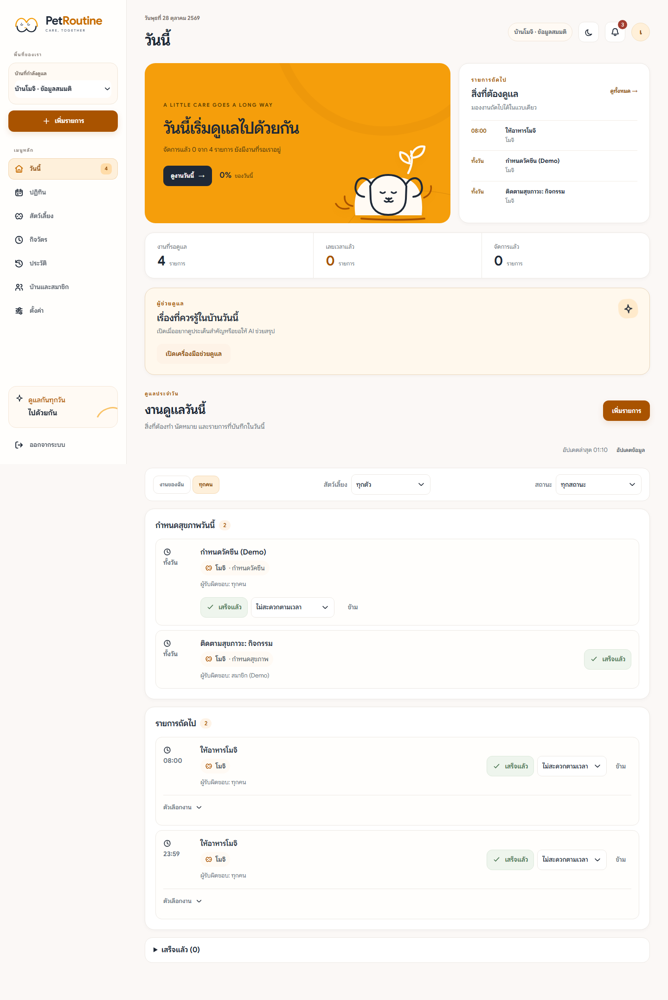
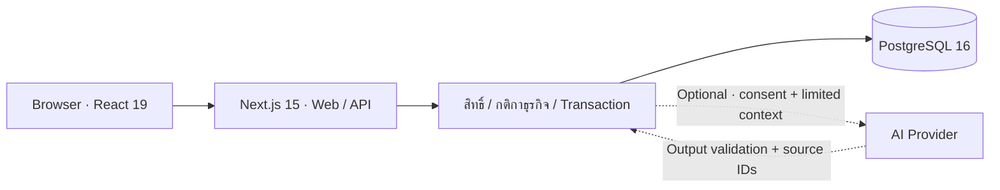

<div align="center">
  

# PawRoutine

**ดูแลสัตว์เลี้ยงร่วมกัน ให้ทุกคนในบ้านเห็นข้อมูลชุดเดียวกัน**

เว็บภาษาไทยสำหรับกิจวัตร ประวัติการดูแล และการติดตามสุขภาวะสุนัข/แมว

`Next.js 15` · `React 19` · `PostgreSQL 16` · `Node.js 22` · `Docker` · `Jenkins`

[รู้จักโปรเจกต์](#overview) · [เริ่มใช้งาน](#quick-start) · [พัฒนา](#development) · [ทดสอบ](#testing) · [เอกสาร](#documentation)

</div>

---

<a id="overview"></a>
## 🐾 รู้จักโปรเจกต์

**PawRoutine** คือระบบจัดการงานดูแลสัตว์เลี้ยงร่วมกันในครอบครัว ชื่อบนหน้าจอคือ **PetRoutine** ออกแบบให้เจ้าของและสมาชิกบ้านตรวจได้ว่า **วันนี้ต้องทำอะไร ใครทำแล้ว และมีเรื่องใดต้องติดตามต่อ**

เริ่มจากสร้างบ้าน เพิ่มสัตว์เลี้ยงและกิจวัตร แล้วใช้ Today/Calendar บันทึกงานและดูสถานะร่วมกัน ข้อมูลสุขภาพและ Wellness ที่บันทึกไว้สามารถเปิดดูประวัติ แนวโน้ม แหล่งข้อมูลต้นทาง และนำออกเป็น Vet Report ได้

> ข้อมูลสุขภาพมาจากผู้ใช้และกฎของระบบ Alert และ AI ใช้ประกอบการติดตาม ไม่ใช่คำวินิจฉัยหรือคำแนะนำเรื่องยา

### ทำอะไรได้บ้าง

| ส่วน | สิ่งที่ผู้ใช้ทำได้ |
|---|---|
| 🏠 **บ้านและสมาชิก** | สร้างบ้าน เชิญผู้ดูแลร่วม และแยกสิทธิ์ Owner/Member |
| 🗓️ **กิจวัตรและปฏิทิน** | สร้างงานรายสัปดาห์ หลายเวลา ทุก X วัน หรือครั้งเดียว พร้อม Today/Calendar เวลาไทย |
| ✅ **สถานะงานร่วมกัน** | ทำเสร็จ ข้าม เลื่อนเวลา และเปลี่ยนผู้รับผิดชอบเฉพาะครั้ง มี confirmation และ Undo ภายใน 8 วินาที |
| 🐶 **โปรไฟล์และสมุดสุขภาพ** | เก็บข้อมูลสัตว์เลี้ยง วัคซีน ยา โรค/การแพ้ และวันนัดหมาย |
| 📈 **Wellness** | เช็กอินรายวัน คำนวณ baseline 14 วัน ดูแนวโน้ม/Alert พร้อมบันทึกต้นทาง และมอบหมายผู้ติดตาม |
| 📄 **ประวัติและรายงาน** | อ่าน Timeline รวมข้อมูลช่วงวันที่เลือก และดาวน์โหลด Vet Report PDF จาก browser |
| ✨ **AI แบบ optional** | ถาม/สรุปข้อมูลที่มีสิทธิ์เข้าถึง และเตรียม draft ให้ผู้ใช้ตรวจยืนยันก่อนบันทึก |

**ตัวอย่างการใช้งาน:** เจ้าของสร้างงานให้อาหาร → สมาชิกยืนยันว่าทำแล้ว → ทุกคนเห็นสถานะเดียวกัน → บันทึก Wellness → เปิดดูแนวโน้มและประวัติเมื่อต้องติดตาม

<details>
<summary><strong>ดูตัวอย่างหน้า Today</strong></summary>

ภาพจากชุดข้อมูลสังเคราะห์ในรอบสาธิต ไม่ใช่ข้อมูลผู้ใช้จริงหรือสถานะสดของระบบ



</details>

<a id="quick-start"></a>
## 🚀 เริ่มใช้งานด้วย Docker

### 1. เตรียมเครื่อง

| เครื่องมือ | ใช้ทำอะไร |
|---|---|
| **Git** | clone และอัปเดต source จาก `main` |
| **Docker Desktop + Docker Compose** | รันเว็บและ PostgreSQL; เปิด Docker Desktop ให้พร้อมก่อนเริ่ม |
| **Node.js 22** | สร้าง config และใช้สคริปต์ในโครงการ |

ต้องเชื่อมต่ออินเทอร์เน็ตในการดาวน์โหลด image/dependencies ครั้งแรก การรันเว็บด้วย Docker ไม่ต้องติดตั้ง npm dependencies บน host

ตรวจว่ามีพื้นที่ว่างสำหรับ Docker images, build cache และ Chromium ก่อนเริ่ม โดยเฉพาะเมื่อจะรันชุด verification

### 2. Clone → Setup → Run

ใช้คำสั่งชุดเดียวกันได้ใน PowerShell, macOS Terminal หรือ Linux shell:

```bash
git clone --branch main https://github.com/GameBoBoo/pawroutine.git
cd pawroutine
node scripts/setup-local.mjs
docker compose up -d --build --wait --wait-timeout 180
```

`setup-local.mjs` สร้าง `.env` พร้อม JWT secret สุ่มและปิด AI เป็นค่าเริ่มต้น ถ้ามี `.env` อยู่แล้วจะไม่เขียนทับ แต่ละเครื่องต้องมี config ของตนเอง Migration รันอัตโนมัติก่อนเว็บเริ่ม

### 3. เปิดเว็บ

| จุดเข้าใช้งาน | URL |
|---|---|
| **PetRoutine** | **http://127.0.0.1:3000** |
| Health check | http://127.0.0.1:3000/api/v1/health |

Health check ควรตอบ:

```json
{"status":"ok","database":"ok"}
```

### 4. ทดลอง flow แรก

1. สมัครบัญชีใหม่และสร้างบ้าน
2. เพิ่มสัตว์เลี้ยง แล้วสร้างกิจวัตรแรก
3. เปิด Today/Calendar และลองทำงานเสร็จ → Undo
4. ใช้อีก browser profile หรือ incognito สมัครบัญชีสมาชิก แล้วเข้าบ้านด้วยรหัสเชิญ
5. เช็กอิน Wellness และเปิด Timeline/Vet Report

**ไม่มีบัญชีกลางที่ต้องใช้ร่วมกัน** แต่ละเครื่องที่รัน local จะมีฐานข้อมูลแยก รหัสเชิญใช้ร่วมกันได้เฉพาะบัญชีที่เชื่อมเว็บ/ฐานข้อมูลชุดเดียวกัน ดู [คู่มือทีมทดสอบ](docs/team-testing.md) สำหรับ checklist และข้อมูลสาธิต

<a id="run-modes"></a>
## เลือกโหมดที่เหมาะกับงาน

| โหมด | เหมาะกับ | เว็บ / ฐานข้อมูล |
|---|---|---|
| **Docker local** | ลองใช้งานและทดสอบฟีเจอร์ | เว็บ `127.0.0.1:3000`; DB ภายใน Docker |
| **Host development** | แก้โค้ดและเห็นผลทันที | เว็บ `127.0.0.1:3001`; DB `127.0.0.1:55430` ผ่าน dev override |
| **Verification container** | รัน automated suite แยกข้อมูล | จัด test server/DB ให้เอง; DB เป็น tmpfs |
| **Course / Jenkins** | ตรวจการส่งมอบตามรายวิชา | เว็บ host `127.0.0.1:3300` ตาม [Course runbook](docs/delivery/course-and-ci.md) |

Local เปิดรับเฉพาะเครื่องตนเอง ใช้ `localhost` หรือ `127.0.0.1` ตามคู่มือ หากนำไปเปิดผ่านชื่อเครื่อง/IP อื่น ต้องจัด HTTPS/secure context สำหรับ browser APIs ที่ mutation flow ใช้ ดู [Configuration](docs/configuration.md)

<a id="development"></a>
## 🛠️ รันโหมดพัฒนา

หลัง clone แล้ว ให้ใช้ PostgreSQL ใน Docker และรัน Next.js บน host:

```bash
node scripts/setup-local.mjs
docker compose -f docker-compose.yml -f docker-compose.dev.yml up -d --wait db
npm ci
npm run db:migrate
npm run dev
```

เปิด **http://127.0.0.1:3001** และกด `Ctrl+C` เพื่อหยุด dev server `.env.example` ตั้ง `DATABASE_URL` สำหรับ host ไว้ที่ port 55430 แล้ว หากเปลี่ยน `PAWROUTINE_DB_PORT` ต้องแก้ port ใน `DATABASE_URL` ให้ตรงด้วย

อย่ารัน dev server กับ build/E2E พร้อมกันใน checkout เดียว เพราะใช้ `.next` ร่วมกัน ใช้ verification container เมื่อต้องการแยกสภาพแวดล้อม

### อัปเดตและดูแลระบบ

บันทึกงานของตนก่อนเปลี่ยน branch จากนั้นอัปเดตรุ่น Docker local:

```bash
git switch main
git pull --ff-only
node scripts/setup-local.mjs
docker compose up -d --build --wait --wait-timeout 180
```

| คำสั่ง | หน้าที่ |
|---|---|
| `docker compose ps` | ตรวจ container และ health |
| `docker compose logs --tail 100 web` | ดู log ของเว็บ/API |
| `docker compose logs --tail 100 db` | ดู log ฐานข้อมูล |
| `docker compose stop` | หยุดบริการ |
| `docker compose start` | เปิดบริการที่หยุดไว้ |
| `docker compose down` | หยุดและนำ container/network ของ project ออก โดยเก็บ named volume |

ข้อมูลคงอยู่ใน named volume หลัง stop/down **อย่าใช้ `docker compose down -v` หากต้องการเก็บข้อมูล** หาก port 3000 ไม่ว่าง ให้ตั้ง `PAWROUTINE_PORT=3002` ใน `.env` แล้วเปิด Compose ใหม่

<a id="testing"></a>
## 🧪 ทดสอบระบบ

### รันชุดตรวจแยกด้วย Docker

```bash
docker compose --env-file .env.example -p pawroutine-team-check -f compose.verify.yml up --build --abort-on-container-exit --exit-code-from verify
docker compose --env-file .env.example -p pawroutine-team-check -f compose.verify.yml down
```

รัน **dependency audit → Unit/API → production build → E2E desktop/mobile** โดยใช้ test DB แยกแบบ tmpfs ผลอยู่ `artifacts/verification/` ชุดนี้ใช้ค่า AI จำลอง และไม่ใช้ `.env` ของผู้ใช้ตามคำสั่งข้างต้น การตรวจ source อย่างเป็นทางการตามรายวิชาให้รันใน Course Container ด้วย

<details>
<summary><strong>รัน tests บน host</strong></summary>

เตรียม dev DB และ `npm ci` ตามหัวข้อพัฒนาก่อน:

```bash
npm test
npm run build
npx playwright install chromium
npm run test:e2e
```

บน Linux ที่ขาด system libraries ใช้ `npx playwright install --with-deps chromium` ซึ่งอาจต้องสิทธิ์ติดตั้ง package Tests สร้างและลบ schema ของตน ควรใช้ DB ทดสอบส่วนตัว ไม่ชี้ไปฐานข้อมูล production

</details>

ดู [ผลทดสอบที่บันทึกและขอบเขตหลักฐาน](docs/testing.md) และ [คู่มือทีมทดสอบ/รายงาน Bug](docs/team-testing.md) ผลของ commit เก่าไม่ใช่การรับรอง source ที่เปลี่ยนภายหลัง

<a id="ai"></a>
## ✨ เปิด AI เมื่อพร้อม

Core care ใช้ได้โดยไม่ใส่ API key หากต้องการ AI ให้ตั้งค่าบัญชี provider ของผู้ทดสอบใน `.env`:

- `PAWROUTINE_AI_ENABLED=true`
- `AI_API_KEY`, `AI_MODEL` และ `AI_BASE_URL` ตามบริการที่ได้รับสิทธิ์

จากนั้นสร้าง web container ใหม่:

```bash
docker compose up -d --force-recreate --wait web
```

Owner เปิด AI ใน Settings ของบ้าน และสมาชิกให้ consent ก่อนใช้ บน Today เข้าผ่าน “เปิดเครื่องมือช่วยดูแล”; ใน Settings/หน้าอื่นที่แสดงปุ่มลอยใช้ “ถาม AI” ได้ คำตอบอ้างอิงข้อมูลตามสิทธิ์ ส่วน draft ต้องตรวจและยืนยันก่อนบันทึก

API key อยู่ฝั่ง server และไม่ส่งขึ้น Git หรือแนบใน Issue ค่าโควตาแอปเริ่มที่ 10 คำขอ/ผู้ใช้/ชั่วโมง ไม่ใช่วงเงินรายเดือนของ provider ดู [Configuration](docs/configuration.md) และ [AI guide](docs/ai-phase-11.md)

<a id="architecture"></a>
## ภายในระบบ



Web และ Backend/API อยู่ใน Next.js application เดียว ส่วน PostgreSQL เป็น container แยก Docker Compose ปกติจึงมีสองบริการหลักคือ `web` และ `db` ดู [Architecture](docs/architecture.md) สำหรับ data flow, failure paths และ CI/CD

<details>
<summary><strong>โครงสร้าง repository</strong></summary>

```text
app/          Pages, API routes และ styles
features/     หน้าจอ/flow แยกตามงาน
components/   UI ที่ใช้ร่วมกัน
lib/          Business rules, services และ database access
db/           Migrations และตัวโหลด migration
scripts/      Setup, migration, demo และ delivery/verification
tests/        Unit/API และ Playwright E2E
public/       Brand assets และฟอนต์พร้อมใบอนุญาต
docs/         ขอบเขต ออกแบบ คู่มือ และหลักฐาน
ci/           Jenkins bootstrap; Jenkinsfile อยู่ที่ root
```

</details>

<a id="documentation"></a>
## 📚 อ่านต่อและร่วมพัฒนา

| ต้องการทำอะไร | เริ่มอ่าน |
|---|---|
| ตั้งค่า env / เปลี่ยนพอร์ต / เปิด AI | [Configuration](docs/configuration.md) |
| ทดสอบฟีเจอร์และแจ้งปัญหา | [Team testing](docs/team-testing.md) · [ผลทดสอบ](docs/testing.md) |
| แก้โค้ดและส่งให้ทีม review | [Contributing](CONTRIBUTING.md) |
| เข้าใจขอบเขตและเงื่อนไขสำเร็จ | [Requirements](docs/requirements.md) · [Acceptance Criteria](docs/acceptance-criteria.md) |
| เข้าใจโครงสร้างข้อมูลและ API | [Architecture](docs/architecture.md) · [API](docs/api-design.md) · [Database](docs/database-design.md) |
| ตรวจสถานะและแผนต่อ | [Project Status](docs/project-status.md) · [Roadmap](docs/roadmap.md) |
| ส่งมอบและตรวจในรายวิชา | [Delivery](docs/delivery/README.md) · [Course/Jenkins](docs/delivery/course-and-ci.md) |
| ดูรายงานและสไลด์ | [Submission report](docs/delivery/submission-report.md) · [Presentation](docs/delivery/presentation.html) |
| หาเอกสารทั้งหมด | [Docs index](docs/README.md) |

ทีมเริ่มทดสอบจาก `main` หลังผู้ดูแล push รุ่นล่าสุดแล้ว จด commit ด้วย `git rev-parse --short HEAD` เมื่อรายงานปัญหา ยังไม่มีผลทดลองผู้ใช้จริงหรือการรับรองทางการแพทย์ ส่วนไฟล์แนบ, email/push, server-generated PDF และการวินิจฉัย/ปรับยาอยู่นอกขอบเขตปัจจุบัน
