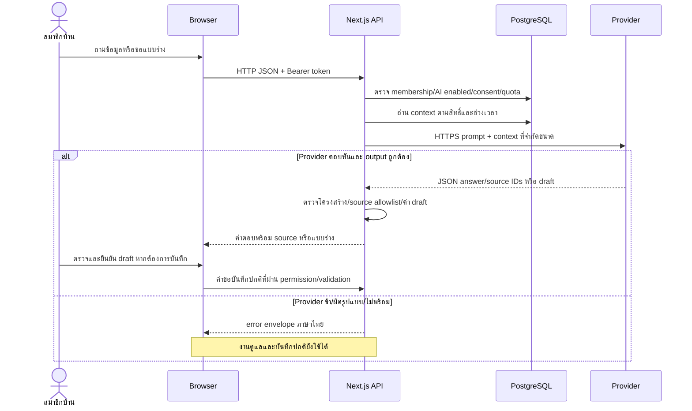
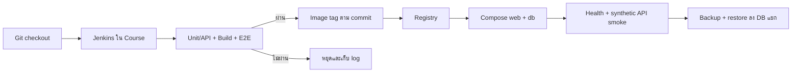

# System Architecture

## Runtime

Browser (React 19/Next.js 15 App Router) → `/api/v1/[...path]` Route Handler → domain services → `pg` transaction → PostgreSQL 16

Route ทำหน้าที่ auth, parse HTTP และ map error ส่วน logic อยู่ใน `lib/services`: access, transaction, household, routine, task, care entry, health record, passport, wellness log, wellness baseline, wellness alert, wellness dashboard, wellness reminder, vet report, activity และ timeline Schedule engine เป็น pure module ที่ `lib/schedule.js`, Baseline Engine อยู่ที่ `lib/wellness-baseline.js`, Change Detection Engine อยู่ที่ `lib/wellness-detection.js` และ Dashboard Aggregation Engine แบบ read-only/pure อยู่ที่ `lib/wellness-dashboard.js`

## Client structure

- `app/page.jsx`: session/workspace orchestration และ legacy screen composition
- `components/`: Icon, Modal, shell contract, UndoBar
- `features/today`: Today workflow และ task controls
- `features/quick-add`, `features/routines`, `features/pets`, `features/activity`, `features/household`: feature views

## Consistency and safety

- task mutation ล็อก row ตรวจ `mutation_version` และใช้ idempotency record
- Undo ล็อก Activity+entity ตรวจเวลาและ version ปัจจุบัน
- product mutations เขียน sanitized Activity ใน transaction เดียวกัน
- membership/Owner/creator guards ป้องกันข้อมูลข้ามบ้าน
- household trash เป็น soft delete: `archived_at` ซ่อนบ้านและปิดการเข้าถึง แต่เก็บ graph ข้อมูลเดิมไว้เพื่อกู้คืนโดย Owner
- schedule/date/display ใช้ `Asia/Bangkok`; projection อนาคตไม่สร้าง task row จนจำเป็น

## Operations

```text
Host browser
    │ http://localhost:3000 (พอร์ตสาธารณะเพียงจุดเดียว)
    ▼
Next.js Web + /api/v1
    │ postgres://...@db:5432 (Docker network ภายใน)
    ▼
PostgreSQL 16 + named volume
```

Docker Compose มี web+db, healthcheck และ named volume ค่าเริ่มต้น publish เฉพาะ web ที่ port 3000; PostgreSQL ใช้ private Docker network ที่ `db:5432` และไม่มี host binding ส่วน `docker-compose.dev.yml` เปิดฐานข้อมูลเฉพาะ `127.0.0.1:55430` เมื่อจำเป็นต้องใช้เครื่องมือจาก host เท่านั้น Web รัน migration ก่อน start และ E2E ใช้ schema สุ่มแยกก่อนลบเฉพาะ schema ของรอบนั้น

Docker web ใช้ `localhost:3000` ส่วน `npm run dev` ถูกบังคับให้ใช้ `127.0.0.1:3001` เพื่อป้องกัน IPv4/IPv6 ชี้ไปคนละเซิร์ฟเวอร์ การหยุดด้วย `docker compose down` ยังเก็บข้อมูลไว้ แต่ `docker compose down -v` จะลบ named volume และไม่ควรใช้กับข้อมูลจริง

## AI และเส้นทางข้อมูล

AI adapter อยู่ใน `lib/services/ai-insight-service.js` และ `ai-care-draft-service.js` ใช้ HTTP JSON ผ่าน HTTPS ไป provider แบบ OpenAI-compatible ชื่อ model/base URL/key อยู่ใน server environment ไม่ส่ง key ไป browser



Context ใช้บันทึกของบ้านตามสิทธิ์ มีขีดจำกัดและต้องแจ้งเมื่อข้อมูลถูกตัด ไม่ใช่ semantic search หรือ clinical model validation Audit AI เก็บ metadata ตาม implementation ไม่เก็บ key ส่วน draft ไม่เขียน care/health record จนกว่าผู้ใช้ยืนยันผ่าน API ปกติ

## Delivery และ Course environment

`Jenkinsfile` และ `compose.verify.yml` ตรวจ unit/API → build → E2E ก่อน build/publish image จากนั้น `compose.delivery.yml` deploy ด้วย named volume, healthcheck, API smoke และ backup/recovery drill แยกจาก `docker-compose.yml` ที่ใช้งานในเครื่องเดิม



ทุก service ของ delivery รันบน nested Docker daemon ของ `tuchsanai/devtools:2569_1` หลักฐานผลจริงอยู่ใน [Course results](delivery/course-results.md) และ [Runbook](delivery/README.md) การมี pipeline file อย่างเดียวไม่เท่ากับรันผ่าน

ข้อจำกัดปัจจุบัน: catch-all route และ `app/page.jsx` ยังมีขนาดใหญ่ ไม่มี push/email, attachment service หรือ server-generated PDF; live-provider quality, งานวิจัยผู้ใช้ และ remote release ต้องอ่านสถานะผลจริงประกอบ
